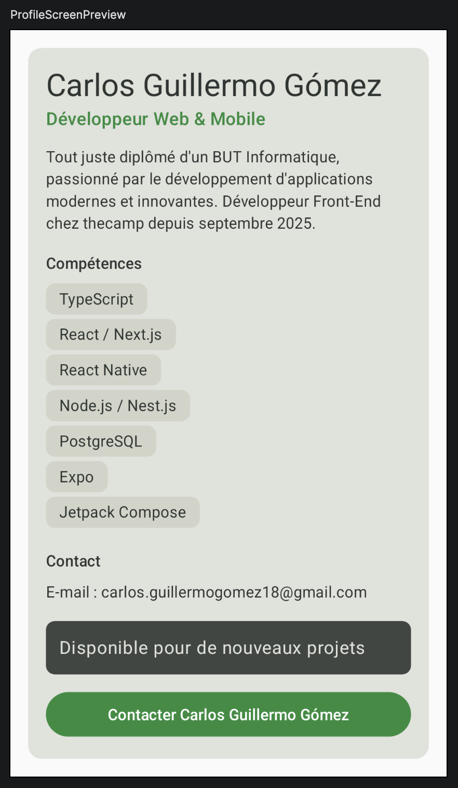
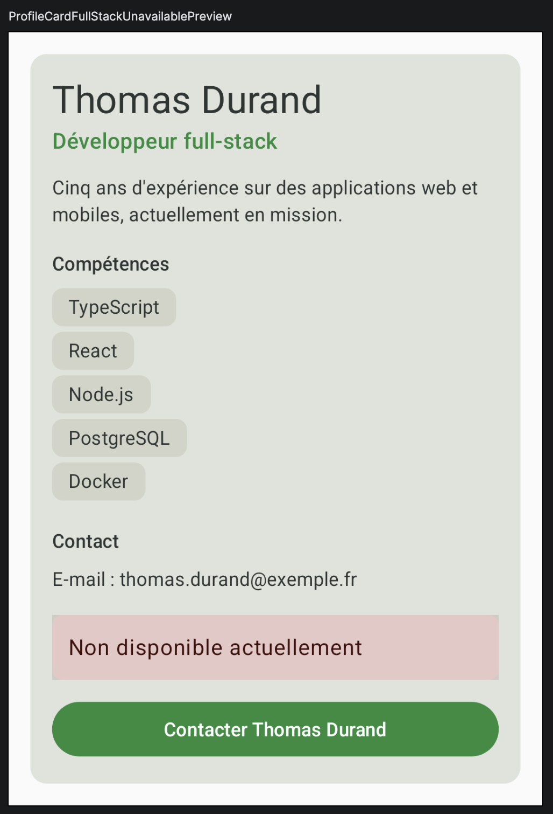

# Profil développeur Compose

Dépôt : https://github.com/CJG2/profil-developper-carlos-guillermogomez

## Description

Cette application Android affiche une fiche « Profil développeur » réalisée avec Jetpack Compose.
L'écran présente le nom, le rôle, une courte description, une liste de compétences et une adresse de contact.
Une zone cliquable indique la disponibilité et un bouton permet de contacter la personne.
Les clics sont simplement remontés au parent via des callbacks mais ne font rien.

## Notions utilisées

- fonctions composables (`@Composable`) ;
- paramètres et composants réutilisables ;
- `Modifier` passé en paramètre (`modifier: Modifier = Modifier`) ;
- chaînage de modifiers (`fillMaxWidth`, `padding`, `clickable`, `semantics`) ;
- padding externe / padding interne ;
- callbacks (`() -> Unit`) ;
- `Scaffold` et `innerPadding` ;
- previews (`@Preview`) ;
- accessibilité de base (`Role.Button`, `contentDescription`).

## Explication

**1. Quels composables avez-vous créés ?**
`ProfileScreen`, `ProfileCard`, `ProfileHeader`, `SectionTitle`, `SkillList`, `SkillItem`, `ContactInfo`, `AvailabilityBadge`, `ContactButton`, ainsi que deux previews (`ProfileScreenPreview` et `ProfileCardFullStackUnavailablePreview`).

**2. Quel composable représente l'écran principal ?**
`ProfileScreen`. Il est appelé depuis `MainActivity` dans le `Scaffold`, avec `Modifier.padding(innerPadding)`.

**3. Où utilisez-vous un padding externe ?**
Dans `ProfileScreen`, lors de l'appel à `ProfileCard` : `modifier.fillMaxWidth().padding(16.dp)`. 

**4. Où utilisez-vous un padding interne ?**
Dans `ProfileCard`, sur la `Column` à l'intérieur de la `Surface` : `Modifier.padding(16.dp)` éloigne le contenu des bords de la fiche. Aussi dans `SkillItem` et `AvailabilityBadge`, où le `Text` est espacé des bords de sa `Surface`.

**5. Quel composant reçoit un callback ?**
`AvailabilityBadge` (`onClick`) et `ContactButton` (`onClick`). `ProfileCard` les reçoit (`onAvailabilityClick`, `onContactClick`) et les transmet. C'est `ProfileScreen` qui fournit les lambdas (vides pour l'instant, avec un commentaire).

**6. Quelle information d'accessibilité avez-vous ajoutée ?**
`AvailabilityBadge` est une `Surface` rendue cliquable : on lui ajoute `clickable(role = Role.Button, ...)` pour que le lecteur d'écran l'annonce comme un bouton, et `semantics { contentDescription = ... }` pour décrire l'action (« Carlos Guillermo Gómez est disponible pour de nouveaux projets. Voir les disponibilités »).
`ContactButton` utilise un `Button` Material : il expose déjà le rôle de bouton et son texte est lu par TalkBack, donc il n'a pas besoin d'informations supplémentaires.

**7. Pourquoi vos composants peuvent-ils être considérés comme réutilisables ?**
Ils ne contiennent pas de données en dur : tout passe par des paramètres (nom, rôle, compétences, disponibilité, texte du bouton, callbacks). Les previews le prouvent : la même `ProfileCard` affiche un profil développeur web & mobile disponible (Carlos Guillermo Gómez) et un profil full-stack non disponible (Thomas Durand).

## Captures

### Profil disponible (`ProfileScreenPreview`)

### Profil non disponible (`ProfileCardFullStackUnavailablePreview`)

